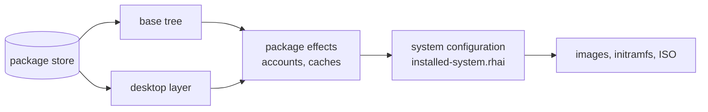

# Build redesign: making an ISO build take minutes, not an evening

Proposal of 2026-11-11, after the first desktop ISO builds. Nothing here is
built. The decisions at the end are the user's.

## What happened on 2026-11-11

Two desktop builds (LevitateOS with Plasma, AcornOS with LXQt) ran for most
of the evening and were stopped at 22:40, both still in their first step:

| | LevitateOS | AcornOS |
|---|---|---|
| Download the locked packages | ~37 min (done twice) | ~5 min |
| Unpack them into the system tree | 762 of ~990 packages after 2 h 40 min | all 970 after ~2 h 50 min, post-install steps still running |
| Failures before that | stale downloads (manual step); one-hour deadline after 256 packages | conflicting polkit packages from the lock generator |

What the time went to, measured:

- **Unpacking, inside Ginux.** Ginux mediates every system call through a
  single-threaded ptrace supervisor: about **35 µs per call** against 0.9 µs
  natively (`getppid`). On top of that each path lookup scanned the whole
  overlay table, 262,144 entries × 360 bytes, often twice. That was 95% of the
  supervisor's time; fixed since in Ginux 3ba33806 (50,000 creates: 1,400 s →
  0.05 s). A stat of a file in the image still costs ~430 µs, cause not yet
  profiled. `rename` still scans (~5 ms per rename), which Alpine's `apk`
  hits once per file.
- **One core.** Downloads, unpacking and compiling run one at a time; the
  machine sat at one busy core per build.
- **Nothing survives a change.** Recipe's cache identity includes the Ginux
  launcher's and Recipe's own bytes, and the builder's source fingerprint
  includes the launcher. Both change daily here, and each change re-downloads
  all packages (37 min) and re-unpacks everything.
- **One giant step.** `fedora-rpm-source-rootfs.rhai` / `alpine-live-source-rootfs.rhai`
  unpack base and desktop packages, apply their script effects and apply the
  whole system configuration (`installed-system.rhai`) in one Recipe run. Its
  own comment: "a change to any of them starts from an empty output". So
  changing one line of desktop configuration re-unpacks all ~990 packages,
  and a failure in the last minute of a 3-hour run loses all of it.
- **Repeated work across products.** The desktop tree re-unpacks the base
  packages the base tree already unpacked; the Qt app build root unpacks
  130–280 packages again; both distros compile the same static tools.

## The principle

**Cache each result by what determines it, at the smallest useful unit, and
make every unit cheap to redo.**

A downloaded RPM is determined by its URL and SHA-256, not by which Recipe
fetched it. An unpacked package is determined by the package and the
unpacking rules, not by the Ginux binary that supervised it. A configured
system is determined by the unpacked packages plus the configuration. Today
all of these are keyed by everything at once, so everything is redone at once.

## The design

### 1. A package store: one unpacked tree per package

- **Downloads** go into a store keyed by SHA-256 (they already carry it in the
  locks). A download is valid forever. No Recipe or Ginux change touches it;
  only a lock change adds new entries. Shared by every product and both
  distros where packages coincide.
- **Unpacking** produces one tree per package, keyed by `(package SHA-256,
  unpacker version)`. The unpacker version is an explicit number in the
  unpacking code (target metadata format, capability handling), bumped when
  its output would change. It does not include the Ginux or Recipe binary.
- **Parallel.** Packages unpack independently: N workers, one Ginux domain
  each, each with a small overlay table sized to one package, not 262,144.
- **Effect:** a lock change that bumps 20 packages unpacks 20 packages. A
  Ginux or Recipe change unpacks nothing. A fresh machine unpacks ~990
  packages on all cores.

### 2. Compose instead of unpack

The system tree is **composed** from package trees: a merge that copies or
reflinks files and their metadata, checks for file conflicts between
packages (which also catches tonight's kind of lock bug early), and writes
the target metadata manifest. Composition is a single bulk operation: one
tar stream through the image writer, not 176,000 mediated `openat` calls.

Layers, each its own cached step:

- **Base tree** = compose(base packages). Shared by base-rootfs, live-boot,
  live-tools and as the bottom of the desktop.
- **Desktop layer** = compose(desktop-only packages) on top of the base tree:
  the base packages are never unpacked twice.
- **Package effects** (accounts from `sysusers.d` / Alpine scripts, library and
  icon caches, `ldconfig`) run on the composed tree, keyed by the composed
  tree's identity.
- **System configuration** (`installed-system.rhai`) is its own step, keyed by
  its inputs and the effects step's output. **Changing desktop configuration
  re-runs only this step and the image steps**, seconds to minutes instead of
  hours.

### 3. Bulk file work does not go through per-call mediation

Unpacking and composition handle verified data; they run no package code
(scripts are never executed, their effects are reimplemented). Two ways to
stop paying 35 µs plus a VFS lookup per file, in order of preference:

- **A Ginux bulk primitive.** The worker hands the supervisor one archive (a
  tar stream) and a destination, and the supervisor writes it into domain
  storage itself, with its own checks, as one mediated operation. This keeps
  "everything runs in Ginux" intact and is useful upstream for any workload
  that unpacks archives.
- **Or unpack in the coordinator.** Recipe's coordinator (outside the domain)
  unpacks digest-verified package archives with a Rust implementation (no
  external `rpm2archive`/`apk` process), and hands the result in as an input.
  Faster to build, but it moves parsing of package archives outside the
  sandbox. Packages are signature- and digest-verified before this point, so
  the input is trusted data, but it is a change to the rule that Recipe's
  operations run in Ginux.

Either way the per-package parallelism of section 1 applies.

### 4. Cache identity: inputs and logic, not toolchain bytes

Today a Ginux or Recipe change rebuilds everything. That was a deliberate
choice (Ginux is developed here and must never be silently stale). The
proposal keeps that guarantee where it matters and drops it where it costs
hours for nothing:

- **Downloads and unpacked packages:** keyed by content and unpacker version
  only (above).
- **Steps that execute code inside Ginux** (package effects, configuration,
  compiles): keyed by their inputs and recipe, plus a **declared Ginux ABI
  version**, a number bumped when a Ginux change can alter what a workload
  observes (syscall semantics, VFS behaviour), not on every commit.
- **Release builds** ignore all caches and build everything from scratch with
  the exact launcher and Recipe, as release evidence requires.

### 5. Short steps with checkpoints

No step should run for hours. With sections 1–2 the longest step is one
package or one composition. The deadlines can go back to minutes, and a
failure costs the failed step only.

### 6. Our own programs

Already decided and partly done: compile each tool crate once for both
distros (builder 9a18ad0), then prebuilt downloads keyed by source
([prebuilt-downloads.md](prebuilt-downloads.md)). The Qt app build root uses
the same package store, so it stops unpacking its 130–280 packages.

## What a build would cost

Rough, from tonight's measurements; to be confirmed by the first runs:

| Change | Today | Redesigned |
|---|---|---|
| Nothing changed, rebuild | hours (identity often changed) | image steps only, minutes |
| One line of desktop configuration | full re-unpack, 3 h+ | configuration + images, minutes |
| Ginux or Recipe commit | re-download 37 min + re-unpack 3 h+ | effects + configuration + images (if ABI unchanged: images only) |
| Lock update, 20 packages | re-download all + re-unpack all | 20 downloads, 20 unpacks, compose |
| Fresh machine | ~4 h+ per distro | downloads (parallel) + unpack on all cores + compose |

## Order of work

1. **Measure what is left in Ginux** (the 430 µs image lookup, `rename`) with
   the fixed launcher on an idle machine, so the remaining per-call costs are
   known before choosing section 3's route.
2. **Package store for downloads**, keyed by SHA-256 (removes the 37-minute
   re-downloads at once).
3. **Per-package unpack trees + composition**, base and desktop layers, with
   parallel workers.
4. **Split effects and configuration** out of the rootfs recipe into their own
   cached steps.
5. **Cache identity** change (section 4) and shorter deadlines.
6. **Bulk primitive in Ginux** (or coordinator unpacking), per decision 2.
7. Prebuilt downloads for our programs, as planned.

Steps 2–4 are builder and Recipe recipe work; step 6 is Ginux or Recipe work.

## Decisions for the user

1. **Cache identity.** Key downloads and unpacked packages by content only, and
   code-running steps by a declared Ginux ABI version instead of the launcher's
   bytes, with release builds still building from scratch. This reverses the
   current "any Ginux change rebuilds everything" for development builds.
2. **Where bulk unpacking runs:** a new Ginux bulk-write primitive (keeps
   everything in the sandbox, more work, upstream-worthy), or unpacking verified
   archives in Recipe's coordinator (faster to build, parsing moves outside
   the sandbox).
3. **Order:** start with the download store and the layer split (biggest
   effect for the least risk), or with the Ginux measurements first.
